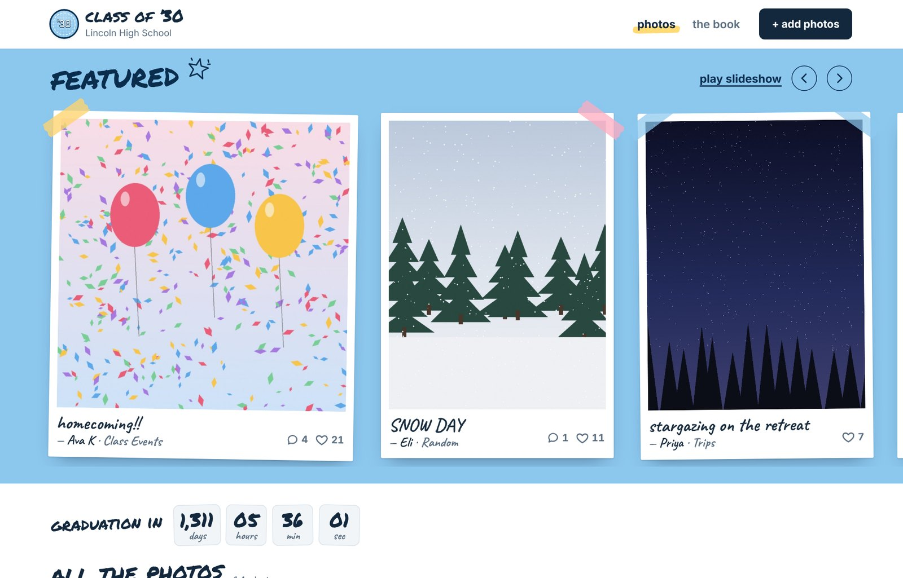
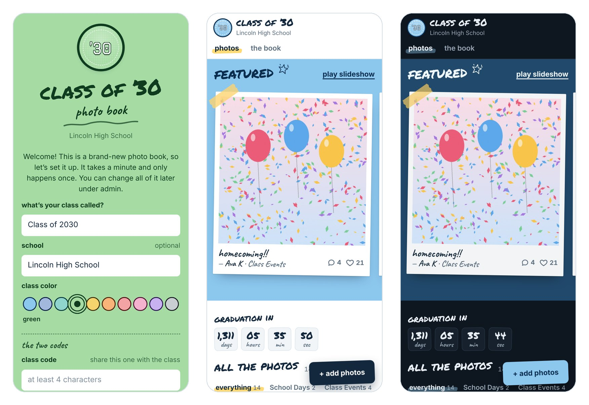
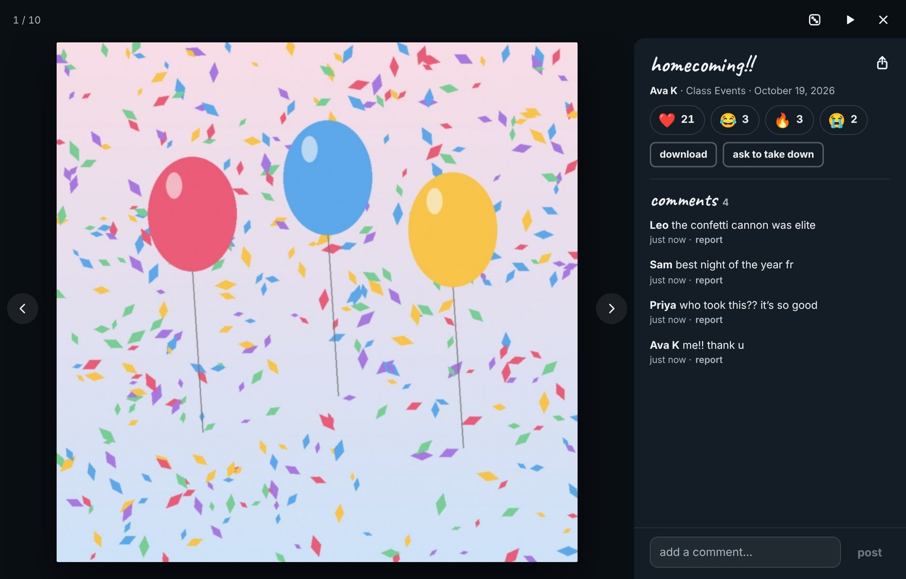
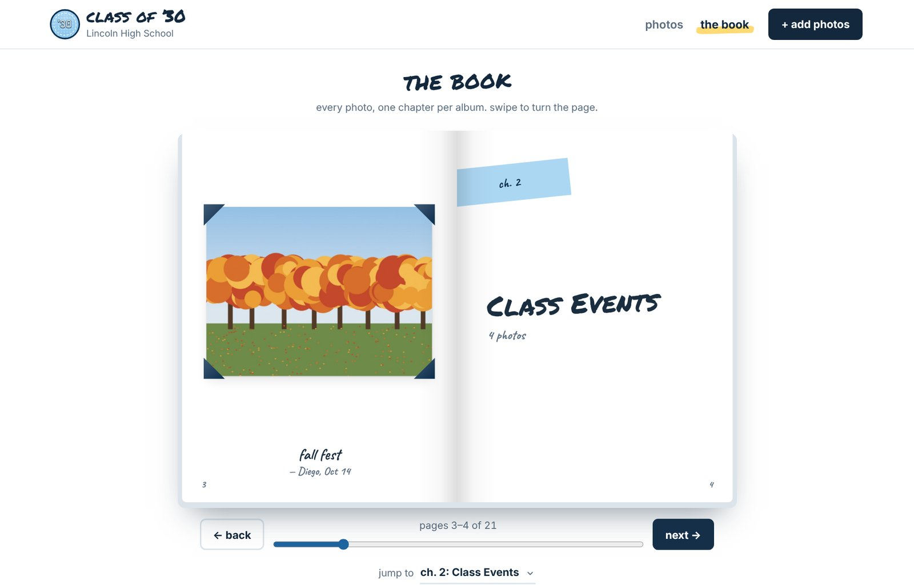

# School Photobook Website

A private photo book website for your class. Classmates upload photos, heart and comment on them, and flip through everything like a real yearbook. It sits behind a class code, runs on almost any cheap web host, and takes about five minutes to set up.

**Two files. No database. No accounts. No build step.**





## What it does

- **Private by default.** Nobody sees a single photo until they type the class code. A separate admin code is just for the people running it.
- **Make it yours in one minute.** The first time it's opened, it asks what your class is called, your school, a class color (10 to choose from), and the two codes. Everything can be changed later.
- **Featured strip.** The most-loved and best-looking photos up top. It quietly rotates every few minutes so new posts get a turn.
- **All the photos.** A polaroid wall with albums (School Days, Class Events, Trips, Sports, Friends, Random, or your own), sorting, and a "most photos" list.
- **The book.** Every photo laid out as a flip book, one chapter per album, with page-turn animations.
- **Reactions and comments.** ❤️ 😂 🔥 😭 on every photo, plus comments.
- **Easy posting.** Add up to 20 photos at once from a phone or computer. Photos are shrunk before upload and their hidden location data is stripped out.
- **Sharing.** A link and QR code for the whole book, and share links that open straight to one photo (people still need the class code).
- **Extras.** Slideshow mode, shuffle, a graduation countdown, light and dark mode, and a layout made for phones first.





### Tools for admins

- Feature photos, or keep them off the featured strip.
- Edit who posted a photo, its caption and its album.
- Rotate, flip, crop, or replace a photo's picture (hearts and comments stay).
- Add, rename, reorder and delete albums.
- **Ask to take down:** anyone can hide a photo right away by giving their name and a reason. An admin then puts it back, moves it to hidden storage, or deletes it.
- **Reported comments** are hidden until an admin looks at them.
- **Upload log and trace:** every upload privately saves the real name (even for anonymous posts), IP address, browser and device, so admins can find out who posted something that breaks the rules.
- **Block** an IP address or a device from posting. Blocked people can still look, but can't post, comment or report.
- Change the name, school, color, class code, admin code and graduation date at any time.

## Set it up

### What you need

A web host that runs **PHP 7.2 or newer**. Most regular web hosting does (if a host offers WordPress, it runs PHP).

Hosts that only serve static files, like GitHub Pages or a static Netlify site, **won't work**. The photo book needs PHP to save photos.

### 1. Download it

Download the zip from the [latest release](../../releases/latest), or click the green **Code** button on this page and choose **Download ZIP**. You only need two files from it: `index.html` and `api.php`.

### 2. Upload the two files

1. Open your host's file manager (in cPanel, hPanel and most others it's called **File Manager**).
2. Go to your website's public folder. It's usually called `public_html`.
3. Make a new folder for the photo book, like `photobook`.
4. Upload `index.html` and `api.php` into that folder.

Your photo book now lives at `https://yourwebsite.com/photobook/`.

### 3. Open it and set it up

Go to that address right away. Since it's brand new, you'll see the setup screen:

| Field | What to put |
| --- | --- |
| **What's your class called?** | Like `Class of 2029`. A year turns into a badge that says '29. |
| **School** | Optional. Shows under the name. |
| **Class color** | Pick one of 10 colors. |
| **Class code** | At least 4 characters. This is what you give to the class. |
| **Admin code** | At least 6 characters. Keep this one to yourself. |

Tap **finish setup** and you're in, already signed in as an admin.

> **Do this as soon as you upload the files.** Whoever opens a new photo book first gets to set it up and pick the admin code.

### 4. Share it

Tap **share** at the bottom of the page for the link and a QR code. Send the class the link **and** the class code.

That's it. Everything people post is saved in a `photobook-data` folder that appears next to `api.php` on the first visit.

### Try it on your own computer first (optional)

If you have [PHP](https://www.php.net/downloads) installed, open a terminal in this folder and run:

```bash
php -S localhost:8000 -d upload_max_filesize=16M -d post_max_size=20M
```

Then open <http://localhost:8000>. To start over, delete the `photobook-data` folder.

## Running the photo book

**Turning on admin mode:** tap **admin** at the bottom of the page and type the admin code. (Typing the admin code on the sign-in screen works too.) A dark bar across the top means admin mode is on. It stays on for 14 days on that device.

**Photos that need a look** (someone asked to take them down, or a comment on them was reported) move to the front of the list with a red dashed outline, and the admin bar says how many there are.

**Changing the codes:** admin → settings. Changing the class code signs everyone else out until they type the new one, which is a quick way to lock out someone who shouldn't have it.

**Forgot the admin code?** Delete `photobook-data/config.php` in your file manager, then open the photo book. It asks you to set it up again. Photos, hearts and comments are kept, but everyone has to type the class code again.

**Backing it up:** download the `photobook-data` folder. That one folder is the whole photo book.

## Updating to a new version

Upload the new `index.html` and `api.php` over the old ones. **Never delete or replace the `photobook-data` folder**, since it holds all the photos and comments.

## Privacy and safety

Please read this before sharing the photo book with a class.

- **The class code is the only lock.** It keeps out people who don't have it, but anyone who has it can see and post everything. Treat it like a group chat, not a vault.
- **The sign-in screen is public.** Anyone with the link can see the book's name, school and color (but no photos).
- **Search engines are told to stay away** (`noindex`), and photos only load for people who typed the class code.
- **What gets saved:** photos (shrunk, with location data removed), captions, names people type, comments, reactions, and for each upload and take-down request the IP address, browser and device. Only admins can see the IP addresses, devices and real names behind anonymous posts. The upload screen tells people this.
- **Where it's saved:** only on your web host, in `photobook-data`. The data files can't be opened from the web. There's no analytics or tracking, and nothing is sent anywhere else. Fonts load from Google Fonts and the QR code script loads from cdnjs.
- **Your school's rules come first.** This is a student-run tool, not an official school site, unless your school decides to run it. Check what your school allows.
- **Built for high school and up.** If anyone in your group is under 13, talk to your school before using it. Laws like COPPA in the US have extra rules for collecting information from young kids.
- **If something illegal gets posted**, especially any nudity of someone under 18: don't download, screenshot or forward it. Hide it, copy the trace, and report it to the police (in the US, also to the NCMEC CyberTipline at <https://report.cybertip.org>). They'll tell you whether to delete it.

### If your host uses nginx

The `photobook-data` folder protects itself on Apache hosts (most shared hosting) with an `.htaccess` file. On nginx, add this to your site's config so the folder can't be opened from the web:

```nginx
location ~ /photobook-data/ { deny all; }
```

## Making changes

Everything lives in two files:

- `index.html` is the whole website: the page, its styles and its script.
- `api.php` is the server side: setup, sign-in, uploads, comments, admin tools, and saving.

Some easy things to change:

| To change | Look for |
| --- | --- |
| The class colors | `COLORS` in `index.html` and `PB_COLORS` in `api.php` (keep them matching) |
| The starting albums | `PB_ALBUMS` in `api.php` (admins can also change albums any time) |
| Reactions | `REACTIONS` in `index.html` and `PB_REACTIONS` in `api.php` |
| How long people stay signed in | `PB_CLASS_DAYS` and `PB_ADMIN_DAYS` in `api.php` |
| Comment length and limits | the `PB_` settings at the top of `api.php` |
| How often featured rotates | `FEAT_MS` in `index.html` |

## Troubleshooting

**"api.php is missing" or "the server sent back something weird"**
`api.php` needs to be in the same folder as `index.html`, and your host has to run PHP.

**"The photobook-data folder isn't writable"**
In your file manager, set the permissions of the folder holding `api.php` (and `photobook-data`, if it exists) to `755`.

**"That photo is too big for the server"**
Your host's upload limit is very low. Photos are shrunk to about 1–2 MB before upload, so raise PHP's `upload_max_filesize` and `post_max_size` to at least 8 MB (most hosts have a PHP settings page for this).

**The class code doesn't work**
Codes ignore spaces and capital letters, so `Go Lions` and `golions` are the same. Make sure cookies aren't blocked. If an admin changed the code, everyone needs the new one.

**I moved the photo book to a new address**
Copy the whole folder (including `photobook-data`). Everyone will need to type the class code once more, since sign-ins don't carry over between websites.

## Contributing

Issues and pull requests are welcome. A few things to keep in mind:

- It should stay **two files** with **no build step**, so anyone can set it up with a file manager.
- It has to keep working on **PHP 7.2**.
- Phones come first. Check every change on a narrow screen.
- Test the first-run setup on a fresh copy (no `photobook-data` folder) before sending a change.

## Credits

- Fonts from Google Fonts: [Permanent Marker](https://fonts.google.com/specimen/Permanent+Marker) (Apache 2.0), [Caveat](https://fonts.google.com/specimen/Caveat) and [Graduate](https://fonts.google.com/specimen/Graduate) (SIL Open Font License).
- QR codes by [qrcode-generator](https://github.com/kazuhikoarase/qrcode-generator) (MIT).
- The photos in the screenshots are made-up drawings, not real people or places.

## License

[MIT](LICENSE). Use it for your class, change it, share it.

This project isn't affiliated with any school.
